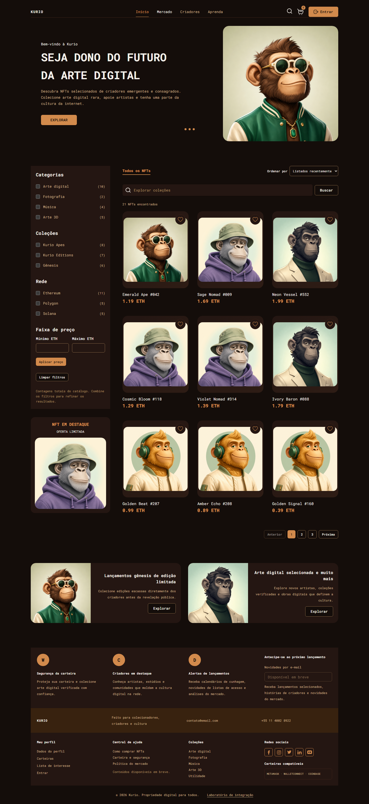
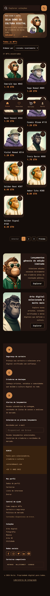

# KURIO — marketplace de NFTs

Projeto de **João Rossetto** para o [Frontend Challenge da Jungle Gaming](docs/CHALLENGE.md). A interface segue a [cópia do Figma oficial](https://www.figma.com/design/mYZDrnYbgsLFgIw7WhQ7DB/Frontend-Challenge--Copy-?node-id=0-1). O link público será incluído após a publicação.

| Catálogo desktop                                                    | Catálogo mobile                                                   |
| ------------------------------------------------------------------- | ----------------------------------------------------------------- |
|  |  |

As capturas acima foram geradas pelo Playwright no build de demonstração. Há também capturas do [detalhe desktop](docs/screenshots/detalhe-desktop.png) e [detalhe mobile](docs/screenshots/detalhe-mobile.png).

## O que funciona

Catálogo com busca, filtros, ordenação e paginação na URL; detalhe com edições e estoque; favoritos por conta; carrinho com cupom; cadastro e login; carteiras simuladas; cotação, revisão e compra idempotente; pedido pendente, confirmação ou recusa; recibo recuperável; perfil, avatar e alteração de senha. A rota `/laboratorio` permite escolher falhas determinísticas, testar Socket.IO e restaurar os dados da demonstração.

Todas as APIs de negócio são simuladas com **MSW no navegador**. O estado persiste no `localStorage` daquele navegador. Não há blockchain, extensão de carteira, transferência de NFT ou pagamento real. Credenciais e tokens fictícios servem apenas à demonstração e não oferecem segurança de produção.

## Stack e arquitetura

React 19, TypeScript, Vite, TanStack Router, TanStack Query, Axios, Zod, Tailwind CSS 4, componentes shadcn/ui adaptados, MSW, Socket.IO Client com `@mswjs/socket.io-binding` e Playwright. As fontes Roboto Mono e as imagens selecionadas do Figma são locais.

`src/features` contém telas e serviços. Serviços usam Axios e validam respostas na fronteira com Zod. `src/mocks` concentra handlers REST, fixtures e regras da simulação; a interface não lê seus stores diretamente. Eventos `nft.updated` e `order.updated` chegam pelo transporte WebSocket interceptado pelo MSW, passam pelo cliente Socket.IO e levam à reconciliação com REST. O worker inicia antes da montagem do React. Mais detalhes em [ARCHITECTURE.md](ARCHITECTURE.md) e nos [contratos](src/shared/api/contracts.ts).

## Executar localmente

Requer Node.js **24.20.0** e npm **11**. O projeto não precisa de chave, conta externa nem backend.

```bash
npm ci
npm run dev
```

Abra `http://127.0.0.1:5173`. Para servir o mesmo build de demonstração usado no release:

```bash
npm run build
npm run preview
```

O preview usa `http://127.0.0.1:4173`. A variável pública `VITE_ENABLE_MOCKS=true` está em `.env.demo`; não coloque segredos em variáveis `VITE_*`.

## Experimentar uma compra em cinco minutos

1. Abra um NFT no catálogo, escolha uma edição disponível e adicione ao carrinho.
2. No carrinho, ajuste a quantidade e, se quiser, aplique `KURIO10`.
3. Entre com `alice@kurio.test` / `KurioAlice2026!` ou crie uma conta fictícia.
4. Em **Pagamento**, selecione uma carteira, conecte a simulação, gere a cotação e revise os valores.
5. Envie o pedido e aguarde a resposta simulada. Abra o recibo novamente ou recarregue a página para verificar a persistência.

Outra conta de teste: `bruno@kurio.test` / `KurioBruno2026!`. Os dados pertencem ao navegador usado. Para recomeçar, abra `/laboratorio` e escolha **Restaurar dados de demonstração**; a ação exige confirmação.

No laboratório, selecione um cenário e use **Aplicar cenário**. Exemplos: `?mock=slow` mostra carregamento prolongado; `?mock=error` devolve 503 no catálogo; `?mock=wallet-declined` recusa a conexão; `?mock=order-declined` recusa a compra; `?mock=timeout-after-create` permite recuperar a mesma tentativa pelo identificador idempotente. Volte a `?mock=success` ou use o reset para retornar ao caso padrão. [STAGE-4.md](docs/STAGE-4.md) descreve os estados da compra.

## Verificações

```bash
npm run check
npm run build
npx playwright install chromium
npm run test:e2e
```

O Playwright inicia seu próprio preview; pare um preview aberto antes de rodar a suíte. Os testes usam Chromium em **390, 768 e 1440 px**. Na última verificação local, **117/117** passaram; typecheck, lint, formatação e build também passaram. Relatórios HTML e traces ficam em `playwright-report/` e `test-results/`, ignorados pelo Git. O workflow em `.github/workflows/ci.yml` executará `npm ci` e essas verificações após o primeiro push; **ainda não há execução de CI no GitHub**.

Para testar uma URL publicada após o deploy, defina `PLAYWRIGHT_TEST_BASE_URL` com a origem HTTPS e execute `npm run test:e2e`. Isso desativa o preview local.

## Lighthouse

Doze medições locais do build de demonstração, três por rota e perfil, com Lighthouse 13.6.0 e Chromium 158:

| Rota    | Perfil  | Performance | Acessibilidade | Boas práticas | SEO |
| ------- | ------- | ----------: | -------------: | ------------: | --: |
| Home    | Mobile  |          92 |             96 |            96 |  92 |
| Home    | Desktop |          99 |             95 |            96 |  92 |
| Detalhe | Mobile  |          93 |            100 |            96 |  92 |
| Detalhe | Desktop |         100 |             97 |            96 |  92 |

As quatro medianas locais atingiram as metas oficiais. [Condições, LCP/CLS/TBT e relatórios brutos](docs/evidence/lighthouse/README.md) estão versionados. Para reproduzir, rode `npm run build`, `npm run preview` e os comandos Lighthouse nessa documentação. A auditoria da URL pública continua pendente de publicação.

## Limites conhecidos

- A simulação e o histórico são locais a cada navegador; não há sincronização entre dispositivos.
- O login e a confirmação em desktop são páginas, enquanto o Figma mostra overlays. O carrinho mobile não reproduz o painel de total fixo, e a lista de carteiras precede o formulário do frame oficial.
- A versão mobile de perfil, carteiras e recibo foi adaptada a partir dos padrões existentes porque não há frames próprios.
- O build emite um aviso de chunk maior que 500 kB. A comparação visual final e o Lighthouse da URL pública ainda precisam ser concluídos.

O [enunciado original](docs/CHALLENGE.md) foi preservado integralmente. Os relatórios por etapa estão em `docs/STAGE-1.md` a `docs/STAGE-5.md`.
